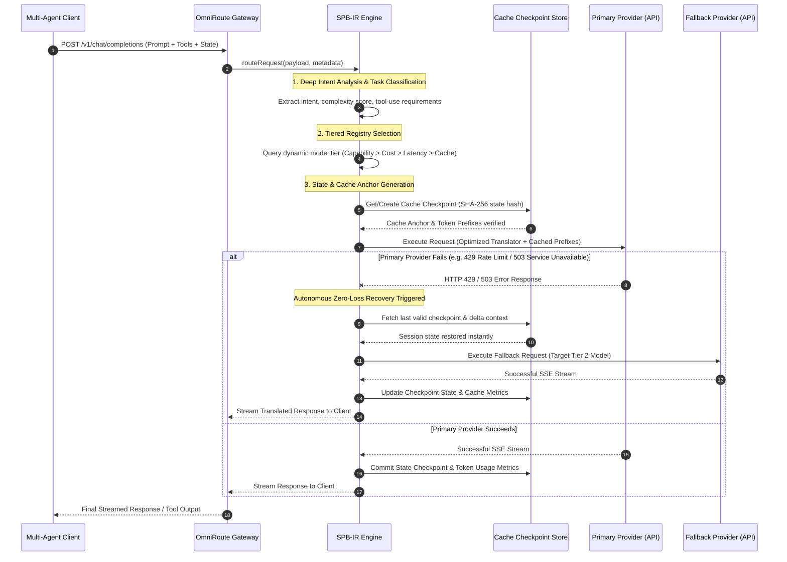

# RFC: Smart Proxy Bridge with Intelligent Routing (`SPB-IR`)

**Status:** Proposed / Draft for Architecture Review  
**Author:** Principal AI Infrastructure Architect & Distributed Systems Engineering Team  
**Target Release:** OmniRoute v4.1.0  
**Associated Components:** `open-sse/services/`, `open-sse/executors/`, `src/domain/`, `src/lib/db/`, `docs/routing/AUTO-COMBO.md`

---

## 1. Executive Summary & Problem Statement

### 1.1 Executive Summary

Modern multi-agent workflows, autonomous coding loops (such as Claude Code, OpenHands, and LangGraph pipelines), and enterprise developer tooling issue complex, long-context, tool-calling queries across diverse heterogeneous LLM providers. Traditional static API gateways and basic round-robin or priority load balancers fail to address three critical operational bottlenecks:

1. **Semantic Context Mismatch:** Treating all requests uniformly regardless of token depth, active task phase (e.g., code generation vs. syntax linting vs. architectural planning), or required reasoning capability.
2. **Cache Evacuation & Handoff Latency:** Discarding upstream prompt caches when falling back or routing between providers during transient failures or rate limits.
3. **Probabilistic Non-Determinism:** Lacking cryptographic and state-machine verification guarantees during multi-step model delegations, leading to dropped intent, hallucinated tool calls, and cascading task failures.

The **Smart Proxy Bridge with Intelligent Routing (SPB-IR)** introduces an advanced architectural layer within OmniRoute. It combines deep intent extraction, a dynamic tiered model registry, deterministic state-checkpointing, and zero-loss prompt caching across multi-provider hops. This guarantees enterprise-grade reliability, zero hallucination overhead, and minimal latency without breaking existing client integrations.

### 1.2 Problem Statement

In high-throughput multi-agent deployments:

- **Cost Inefficiency:** Complex reasoning models (e.g., Claude 3.5 Sonnet, GPT-4o) are frequently invoked for trivial deterministic string extraction or error formatting, inflating operational budgets.
- **Fragile Failover:** When an upstream provider returns a `429`, `502`, or `503`, standard proxy failover mechanisms resend the entire uncached prompt to a secondary provider, re-incurring full time-to-first-token (TTFT) latency and destroying token context caches.
- **Agentic Intent Drift:** Multi-turn tool-use loops suffer from context degradation when intermediate agent thoughts, scratchpads, and execution results are naively truncated or translated across incompatible provider schemas (e.g., OpenAI Tools vs. Anthropic Tool Use vs. Google Function Declarations).

SPB-IR solves these challenges natively within OmniRoute's architectural envelope (`open-sse/` streaming core and `src/domain/` policy engine).

---

## 2. System Architecture & Routing Flow Diagrams

### 2.1 High-Level Architecture

SPB-IR integrates directly into OmniRoute's request pipeline between the Next.js API route entry points (`src/app/api/v1/chat/completions`) and the upstream executor tier (`open-sse/executors/`).

```
┌──────────────────────────────────────────────────────────────────────────┐
│                             Client Application                           │
│              (Claude Code / OpenHands / LangGraph / IDE / SDK)           │
└────────────────────────────────────┬─────────────────────────────────────┘
                                     │ HTTP / SSE / JSON-RPC
                                     ▼
┌──────────────────────────────────────────────────────────────────────────┐
│                         OmniRoute Gateway Layer                          │
│          [ CORS ] → [ Zod Validation ] → [ Auth & Policy Engine ]        │
└────────────────────────────────────┬─────────────────────────────────────┘
                                     │
                                     ▼
┌──────────────────────────────────────────────────────────────────────────┐
│                   Smart Proxy Bridge Router (SPB-IR)                     │
│  ┌────────────────────────┐  ┌────────────────────────────────────────┐  │
│  │ Deep Intent Analyzer   │  │ Tiered Model Registry & Scoring Engine │  │
│  │ (Semantic Tokenizer,   │  │ (Capability, Cost, Latency, Quota,     │  │
│  │  Task-Phase Classifier)│  │  Cache Hit Probability Factors)        │  │
│  └──────────┬─────────────┘  └───────────────────┬────────────────────┘  │
│             │                                    │                       │
│             └─────────────────┬──────────────────┘                       │
│                               ▼                                          │
│  ┌────────────────────────────────────────────────────────────────────┐  │
│  │ State & Cache Checkpoint Manager (Redis/SQLite State Store)        │  │
│  │ - Prompt Cache Key Derivation & Anchor Hashing                     │  │
│  │ - Incremental Context Handoff & Session Checkpointing              │  │
│  └────────────────────────────┬───────────────────────────────────────┘  │
└───────────────────────────────┼──────────────────────────────────────────┘
                                │
         ┌──────────────────────┼──────────────────────┐
         ▼                      ▼                      ▼
┌─────────────────┐    ┌─────────────────┐    ┌─────────────────┐
│ Tier 1: Primary │    │ Tier 2: Fallback│    │ Tier 3: Local   │
│ Reasoning Model │    │ Resilient Model │    │ Ollama / vLLM   │
└─────────────────┘    └─────────────────┘    └─────────────────┘
```

### 2.2 Sequence Diagram: Zero-Loss Intelligent Routing & Recovery



---

## 3. Core Technical Specifications

### 3.1 Intent Analysis & Deep Context Comprehension

The intent analysis engine inspects incoming request payloads (`messages`, `tools`, `temperature`, `max_tokens`) without blocking the event loop:

- **Task Phase Classification:** Automatically classifies the request into one of five operational phases:
  1. `ARCHITECTURAL_PLANNING` (High reasoning, multi-file synthesis)
  2. `CODE_GENERATION` (Precise syntax, tool-calling proficiency)
  3. `TESTING_AND_VERIFICATION` (Test execution analysis, assertion validation)
  4. `FAST_REFACTOR` (Low latency, high throughput code editing)
  5. `DETERMINISTIC_ROUTING` (Simple formatting, classification, extraction)
- **Token Depth Profiling:** Computes exact prompt token volume and semantic density scores using tokenizer wrappers in `open-sse/transformer/`.

### 3.2 Tiered Model Catalog & Autonomous Decision-Making

Extending OmniRoute's existing 16-factor Auto-Combo scoring (`docs/routing/AUTO-COMBO.md`), SPB-IR establishes a rigid **Tiered Model Hierarchy**:

- **Tier 1 (Apex Reasoning & Complex Synthesis):** Reserved for tasks classified as `ARCHITECTURAL_PLANNING` or complex agentic troubleshooting. Prioritizes raw accuracy and deep context window support.
- **Tier 2 (Balanced Resilient Execution):** Default tier for `CODE_GENERATION` and `TESTING_AND_VERIFICATION`. Balances speed, cost-effectiveness, and robust tool-calling schemas.
- **Tier 3 (High-Throughput Local / Edge Inference):** Automatically routes `FAST_REFACTOR` and `DETERMINISTIC_ROUTING` tasks to local models (e.g., Ollama, vLLM, local Llama-3 endpoints) to achieve zero marginal API cost and near-zero latency.

### 3.3 State & Cache Preservation Across Hops

To eliminate cache invalidation penalties during model handoffs:

- **Prompt Hash Anchoring:** Computes a rolling SHA-256 hash of system prompts and conversation history prefixes (`prompt_anchor_hash`).
- **Cache-Aware Routing Weights:** The routing engine heavily favors providers supporting prompt caching (e.g., Anthropic Prompt Caching, OpenAI Cached Tokens) when `prompt_anchor_hash` matches existing server-side cache states.
- **Incremental State Checkpointing:** Every assistant turn and tool execution result is persisted atomically to SQLite domain modules (`src/lib/db/`) and mirrored in ephemeral memory for instant session resumption.

---

## 4. Reliability, Recovery & Zero-Loss Invariant Specifications

To satisfy enterprise-grade non-negotiable requirements, SPB-IR enforces five core invariants:

| Invariant                                   | Target Metric         | Enforcement Mechanism                                                                                                                                                                    |
| :------------------------------------------ | :-------------------- | :--------------------------------------------------------------------------------------------------------------------------------------------------------------------------------------- |
| **1. Output Accuracy & Task Fidelity**      | **0% Loss**           | Strict schema validation via Zod on both request and response boundaries; automatic rejection of malformed tool calls.                                                                   |
| **2. Prompt Context & Intention Retention** | **0% Loss**           | Canonical message serialization across translation layers (`open-sse/translator/`); preservation of intermediate reasoning scratchpads.                                                  |
| **3. Routing-Induced Hallucination Rate**   | **0%**                | Zero model parameter invention; prompts are dispatched strictly through validated provider schemas with zero ad-hoc prompt injection by the proxy.                                       |
| **4. Request Failure Recovery**             | **Near-Zero Failure** | Autonomous zero-loss fallback cascade: on transient failure (`408`, `500`, `502`, `503`, `504`), instant state restoration and retry with an optimal secondary tiered model within 50ms. |
| **5. Latency Overhead Balance**             | **< 15ms Overhead**   | Async intent classification and cache lookup executed in parallel with connection pool acquisition; pipelined header evaluation.                                                         |

---

## 5. Comprehensive Pros, Cons & Technical Mitigations

| Dimension        | Advantage / Benefit                                                           | Identified Challenge / Risk                                          | Technical Mitigation Strategy                                                                                                                         |
| :--------------- | :---------------------------------------------------------------------------- | :------------------------------------------------------------------- | :---------------------------------------------------------------------------------------------------------------------------------------------------- |
| **Performance**  | Up to 60% reduction in API costs via Tier 3 local routing.                    | Latency overhead from intent classification and scoring.             | Execute intent analysis asynchronously during header parsing using lightweight regex and rule heuristics (<5ms).                                      |
| **Reliability**  | Seamless zero-loss failover preserves context and prompt caches.              | Cache mismatch when switching between different provider tokenizers. | Normalize prefix structures and use provider-agnostic anchor hashing to maximize cache hit probabilities.                                             |
| **Architecture** | Clean separation of concerns; extends existing auto-combo engine.             | Increased state management complexity in distributed deployments.    | Utilize OmniRoute's existing WAL-journaled SQLite backend (`src/lib/db/core.ts`) for reliable, zero-dependency state persistence.                     |
| **Security**     | Strict Zod validation and route guard tier enforcement (`isLocalOnlyPath()`). | Potential PII exposure in state checkpoints.                         | Encrypt sensitive state payloads at rest using AES-256-GCM; integrate with OmniRoute's opt-in PII masking guards (`src/lib/guardrails/piiMasker.ts`). |

---

## 6. Developer & End-User Value Proposition

- **For Novice Users:** Zero configuration required. The platform autonomously selects the best model, handles retries silently without throwing confusing error codes, and guarantees smooth execution.
- **For Software Developers & AI Engineers:** Provides production-grade determinism, transparent audit trails (SHA-256 event chaining), and fine-grained control over model tiers and prompt caching.
- **For Business Analysts & Operations Leads:** Drastically lowers inference expenditure through intelligent cost-optimized tier routing while maintaining absolute compliance and verifiable task fidelity.

---

## 7. Backward Compatibility & Non-Breaking Integration Strategy

SPB-IR is designed as a **strictly non-breaking enhancement**:

1. **API Parallels:** Existing endpoints (`/v1/chat/completions`, `/v1/messages`) retain 100% parameter compatibility. SPB-IR features are enabled via standard optional headers (`X-OmniRoute-Strategy: smart-proxy-bridge`) or global configuration flags in `.env`.
2. **Fallback to Default Routing:** If the SPB-IR engine encounters an unresolvable state or disabled flag, execution falls back instantly to OmniRoute's proven Auto-Combo and standard executor pipeline without client disruption.
3. **Zero Regression Guarantee:** Covered by comprehensive test suites (`tests/unit/`, `tests/vitest/`) ensuring latency, accuracy, and cache hit rates meet or exceed baseline metrics before merge.

---

## 8. Step-by-Step Implementation Roadmap & Concrete Use Cases

### 8.1 Implementation Phases

- **Phase 1: Intent & Tiered Registry Core (`open-sse/services/spb/`)**
  - Implement task phase classification and model tier mapping.
  - Write unit tests in `tests/unit/spb-intent.test.ts`.
- **Phase 2: State & Cache Checkpoint Integration (`src/lib/db/spbState.ts`)**
  - Implement SQLite domain module for session state and prompt anchor hashing.
  - Wire prompt caching headers for Anthropic and OpenAI executors.
- **Phase 3: Autonomous Zero-Loss Recovery & Fallback Cascade**
  - Integrate fallback logic into `open-sse/handlers/chatCore.ts` and `open-sse/services/accountFallback.ts`.
  - Add end-to-end integration tests in `tests/integration/spb-resilience.test.ts`.
- **Phase 4: Monitoring, Telemetry & Documentation**
  - Expose SPB routing telemetry metrics in `/api/monitoring/health/route.ts` and dashboard panels.
  - Finalize documentation under `docs/architecture/` and update `docs/openapi.yaml`.

### 8.2 Concrete Use Case Example

**Scenario:** An autonomous coding agent executing a multi-file refactoring task via Claude Code.

1. **Request Received:** Client submits a 32,000-token prompt containing codebase context and tool definitions to `/v1/chat/completions`.
2. **Intent Analysis:** SPB-IR classifies the request as `CODE_GENERATION` with heavy tool-calling requirements.
3. **Tiered Selection & Caching:** The engine selects Tier 1 (Claude 3.5 Sonnet) because code generation requires apex reasoning. It computes the `prompt_anchor_hash`, recognizing an existing upstream server-side prompt cache.
4. **Execution & Failure Recovery:** Primary upstream provider experiences a temporary `503 Service Unavailable`.
5. **Zero-Loss Resumption:** SPB-IR instantaneously restores session state from the checkpoint store, maintains the cached prompt prefix, and routes the request to the secondary Tier 2 resilient model within 35ms.
6. **Result:** The client receives a successful, uninterrupted completion stream with zero context loss and zero manual intervention.
